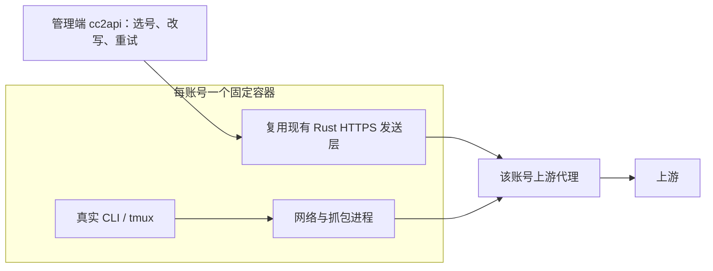

# Brief — v3 大版本：固定账号 Docker 与统一登录、管理和部署

## Goal

- 交付与旧版独立运行的 v3，让登录、任务和 API 上游连接归属每账号的固定 Docker 环境，并统一管理与构建启停。

## Scope

- 两个镜像：管理镜像包含 cc2api、调度器和后台；账号镜像包含 CLI/tmux、开发工具、网络/抓包和 HTTPS 发送器。每账号一个容器，管理镜像分别启动两个服务容器，N 个账号共 N+2 个容器。
- 首次创建环境后在真实 CLI/tmux 内登录；后续任务、养号、抓包、续聊及 API 发送复用完整 HOME、已确认身份和配置。
- 融合账号、环境、任务与证据管理，统一凭据刷新、CLI 串行和环境维护协调；将现有 HTTP/TLS 发送层抽到账号容器。
- 联合构建两个镜像，交付版本清单、Compose 和统一启停入口；支持环境维护、恢复及 v3 自身回退。

## Non-Goals

- 遥测专项继续暂缓；5h/7d 可配置养号停止阈值已记录 roadmap，本轮保留现有用满暂停与恢复。
- API 不改成 CLI 推理，不更换现有请求画像/TLS 算法，不引入 KVM 或修改版 CLI。
- 不执行生产部署、旧账号接管、真实账号实验或发布推送；固定 Docker 不作为防封保证。

## Technical Overview

- 发送器建立上游连接并流式返回；管理端保留现有响应、错误及额度处理。内部桥接传递原始字节、背压与取消，不自行重试；提交状态不确定时不得盲目重发或回退为管理端直连。
- cc2api 是绑定账号唯一刷新者，CLI 使用不含刷新令牌的运行凭据。同账号普通 CLI、养号、抓包与 API 独立调度；CLI 之间串行，养号只让位于正式 CLI 工作。重授权及环境配置维护保留排他门禁。API 准备发送器无需安装或等待 CLI 版本。

## Context & Decisions

- 当前任务与登录环境会销毁，API 的 HTTPS 由中央网关发送；此次同时改变环境生命周期和连接归属，保留协议处理规则。
- API 与 CLI 共用账号环境及代理配置，各用自己的客户端；同容器不能证明完整设备指纹或 TLS 相同。身份字段按实际语义继承，既有有效值不覆盖，来源不明不猜测。
- v3 使用独立分支、镜像标签、数据、网络、容器标签及管理会话；建议宿主端口 18080，启动前必须检查实际占用，冲突拒绝启动。
- 管理端与调度器分别拥有自己的数据库，通过受控接口协作；账号容器不挂 Docker socket 或管理端刷新令牌目录。CLI 非 root 且不继承网络管理能力。

## Risks

- 发送层拆分必须验证请求字节、头顺序、SSE、取消与重试兼容；本地 TUN 不能把 Rust 发送链路再次 MITM 或形成代理循环。
- 合并账号内进程后需验证权限、健康联动及退出收口；持久 HOME 的会话统计、抓包归属和租约故障不能污染下一作业。
- 同宿主仍共享物理资源，需限制活跃环境、CPU/内存和日志；活动 API/SSE/CLI 不能被空闲停机中断。真实 CLI 与身份映射验证条件尚待具备。

## Acceptance

- 登录断线重连保持同一 tmux；连续任务、续聊和环境重建保留 HOME 与有效身份，同版本安装可复用，取消重授权不破坏旧凭据。
- mock 证明 HTTPS 来自对应账号容器，账号间传输实例/连接池独立；原协议回归通过，桥接异常无直连回退或重复提交。
- 同账号普通 CLI 与 API 可并行，取消 CLI 不终止 API 长流；维护排他、CLI 之间串行；抓包来源正确、结束撤销，额度暂停恢复保持原会话，CLI 失联后只阻止下一 CLI，完成对账后恢复；旧排他记录保守处理。
- 一套命令构建、启动、检查及停止两个镜像；版本/端口/挂载冲突拒绝，启停与清理仅操作 v3 资源，旧容器和数据保持原状态。
- 先以本地 mock、独立 Docker 测试环境和空数据库验证；真实验证未执行时明确记录。

## Next Step

- 进入实现后，先完成账号内发送层的本地 mock 验证，确定传输契约及 SSE/取消行为。
