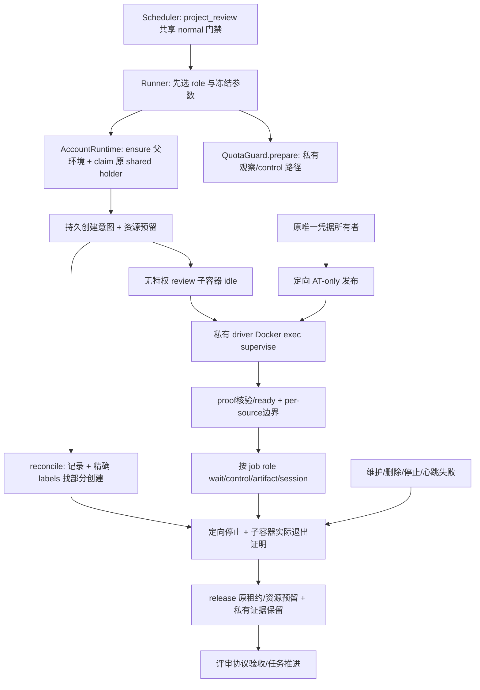

# Research: 评审子容器生命周期实施映射

- Query: 核对同账号评审子容器的创建、wait、control、cleanup、凭据刷新和来源用量接入点，给出精确现有签名、字段与必须一起扩展的最小变更图。
- Scope: internal；只读产品代码与相关规范，只写本研究文件；不改产品、三件套或规范，不运行 Docker、模型、产品测试或 Git。
- Date: 2026-10-21

## Findings

### 1. 文件与查阅范围

| 文件 | 用途 |
| --- | --- |
| `orchestrator/account_runtime.py` | 共享 CLI 槽位、作业持久登记、监督进程、控制、收口、恢复与路径解析。 |
| `orchestrator/account_isolation.py` | 三角色精确标签、资源分配、网络挂接和挂载配置。 |
| `orchestrator/main.py` | Runner、Scheduler、唯一凭据所有者、QuotaGuard 和原生 usage 入口。 |
| `orchestrator/resource_budget.py` | 已保存账号 RAM/swap 的三角色分配。 |
| `orchestrator/cli_quota.py` | 仅消费官方状态栏/主响应的本地白名单额度采集。 |
| `images/account/cli-control.py` | Docker exec 监督器、子进程证明及定向控制。 |
| `images/worker/entrypoint.sh` | 当前 driver、凭据同步/刷新协议及持久 HOME 路径。 |
| `orchestrator/project_iteration.py` | 旧项目原生日志字节边界与 Run/步骤 usage 聚合。 |
| `orchestrator/test_account_runtime.py` | 共享槽位、代次、重启恢复、角色权限与凭据保护的现有回归入口。 |

行号对应本次读取的工作区，主会话并行实现后可能移动。以下明确区分现有字段和建议新增字段，不能将后者当作已实现接口。

### 2. 现有作业结构与不能改变的归属

- `claim(row, account, source, idle_only=False, exclusive=False, shared_cli=False)`（`account_runtime.py:1005`）创建 `job`：`row/account/source/lease/exec/claimed/exclusive/shared_cli/last_used/lease_lock/token`，`_register_job()`（`:236`）以 `environment_id + ':' + source` 登记共享作业。评审应占这个既有 holder，`shared_cli=True, exclusive=False`，继续受 `cli_limit` 1/2 和同账号网关租约约束。
- `token=execution_token(row.container_id or environment_id, source)`（`:285`、`:1058`）目前是逻辑作业句柄。可保留这一稳定生成式，让私有容器 ID 独立作为作业字段；不可把 `account_environments.container_id` 改为子容器 ID，也不可创建后悄悄改变已经返回的 token。
- `_execution_path(job)`（`:248`）的共享记录是原环境 `runtime/executions/<source_sha256>.json`；固定 CLI 只挂 `runtime/cli/drivers/runs/jobs/access` 等子树，并未挂该登记目录。这里可以保存无秘密的恢复元数据，但实际隐藏输入、HOME、transcript、driver 和状态根必须在原 CLI 全部挂载根之外。
- `_save_execution(job)`（`:1115`）当前 `schema=2`，`container_id` 固定写 `job.row.container_id`，白名单只拷贝 `exec/handle/tmux/tmux_socket/hooks_before/statusline_before/statusline_command/version/process/process_permitted/run_id/settings_override/network_inspection_mode`。因此任何新 role/container/private-root/创建阶段字段若只写入内存，都将在重启丢失。
- 建议新增的恢复元数据至少表达：执行角色、实际执行容器 ID、预先固定的创建意图/精确 source 摘要、父环境 generation、私有持久根、私有 runtime/session/observations 相对位置、创建/启动/已收口阶段。字段名与 schema 兼容策略由实现统一确定；旧缺角色记录必须按固定 CLI 解释，不得把旧证据自动迁成评审。
- `job_for_container(container_id)`（`:2053`）只接受完整 token，或唯一匹配 `job.row.container_id` 的裸固定 CLI ID。评审异步回调继续用完整 token，不以私有容器裸 ID 猜来源。

### 3. 创建与网络：可复用部分和必要分支

| 现有入口 | 实际行为 | 评审需要的最小扩展 |
| --- | --- | --- |
| `Runner.start_run(run_id, account, task)`（`main.py:3876`） | 在调用 AccountRuntime 前创建普通 workspace/flows、处理模型快照、调用 `_quota_mounts`。 | 在共享路径准备之前识别已持久化 `project_review`；评审不能先经过普通共享 `execution_flows` 或原 HOME 配置回写。传递角色须来自 Run/冻结归属，不能信任模型输入。 |
| `AccountRuntime._cli_setup(account, source, version, idle_only=False, exclusive=False, allow_inactive_login=False, shared_cli=False)`（`:1226`） | `ensure` 原三角色、核对画像、claim、准备版本，在环境锁内 yield；异常 cleanup。 | 可复用原环境/版本/claim 前半段。评审的私有 HOME/设置/挂载和创建阶段须显式分支；创建意图应在创建容器之前持久保存。 |
| `account_isolation.create_environment(runtime, row, account, name, write_json)`（`account_isolation.py:66`） | 只创建固定三角色，`launch` 会写 `ROLE_COLUMNS[role]`，故不能直接塞第四 role。 | 新受控子容器创建辅助函数；父环境固定三列不增写。复制既有无特权业务角色边界，精确核对 image/release/network/generation/source。 |
| `role_container(runtime, row, role, allow_old_release=False)`（`:33`） | role 必须在三角色 `ROLE_COLUMNS/ROLE_LABELS`。 | 新作业级容器解析器根据已登记角色返回固定 CLI 或严格核验子容器，供 control/cleanup/metrics 使用。保留三角色字段本义。 |
| `_ensure_version(container, version)`（`account_runtime.py:742`） | 经 `_row_for_container` 查原固定 CLI，再让 network 安装指定版本。 | 继续传原固定 CLI；review 私有容器只只读挂同一版本缓存。不能直接传 review 容器。 |
| `_configure_network_context(container, context, reuse_passthrough=False, require_reuse=False)`（`:1517`） | 同样依赖原固定 CLI 查父 row，再在 network 检查 ACK。 | 仍通过原固定 CLI/明确父 row 配置共享 passthrough；已有兄弟时 require_reuse。不重启公共 relay、不建新代理、不回退直连。 |

`_row_for_container()`（`:751`）只有 `SELECT * FROM account_environments WHERE container_id=?`；新子容器不存在对应 DB 行，这两个旧调用的参数不能替换成 review 容器。

子容器应沿用 `account_isolation.py:139–153,191–206` 的 `read_only=True`、`user=1000:1000`、`cap_drop=['ALL']`、`no-new-privileges:true`、独立 PID/mount、`network_mode='container:'+network.id` 及只读机器/系统画像/解析器挂载。只挂私有 HOME、只读冻结输入和 driver、受控 jobs/runs/control、本 source 白名单观察目录及 AT-only access；不挂原 home/projects/flows/runtime 父树、Docker socket、设备、sender 秘密或管理侧完整凭据。

**必须先 `v3-cli-control idle` 再 Docker exec `supervise`。** 当前 `_attach_process`（`:1570`）要求 `pid>1, parent=0, uid=1000`；`images/account/cli-control.py:68–85,186–214` 同样检查 Docker exec 归属。直接把 supervise 作为容器 PID1 会不符合现有证明链。保留 idle+exec 后，可以复用同一 proof/ready/result 协议；评审的 proof、result 和 ready 使用私有挂载。

### 4. wait、control、收口与重启必须同时改的点

| 方法/位置 | 固定假设 | 必须闭合的差异 |
| --- | --- | --- |
| `wait_worker(container_id)`（`:1553`） | exec inspect 本身可复用；共享作业额外调用 `_process_result`。 | 按登记 exec 等待；私有 result 路径必须分派。不能用 driver 退出码代替整个 review 容器进程退出证明。 |
| `_attach_process(job, path)`（`:1570`） | 读传入 proof 后调用 control；保存可信内核身份再发 ready。 | 私有 path + 正确容器 control；完整保留 source/pid/started/uid 校验。 |
| `control_execution(token, operation)`（`:1590`） | 固定 `self._container(job['row'])`。 | 由新作业级解析器选真实容器；inspect/freeze/resume/stop-job 仍按 source/pid/started，旧 token 不碰新容器。 |
| `_process_result(job)`（`:1613`） | 固定 `root/runtime/jobs/<handle>/process-result.json`。 | 从持久私有根定位，继续核对 proof 的 source/pid/started。 |
| `_cleanup_shared_job(job, container)`（`:1625`） | 固定 proof 路径，定向 stop，再 exec inspect 与 orphans 检查。 | 私有 proof/result/control；在精确子容器中完成定向收口，然后停止该子容器并确认实际已退出，再释放 holder。只有该独立容器能作为清理范围；不能停止原 CLI/健康兄弟/network/sender。 |
| `cleanup(container_id)`（`:1661`） | 进入时固定取原 CLI，再选 shared 分支。 | 取作业容器/私有根，role 分派；review 的停止成功持久化后才 release；失败保持恢复证据与 CLI 隔离。 |
| `release(job)`（`:1138`） | 仅确认 exec 非运行；旧本地完整 HOME凭据回 profile。 | review 释放还须证明私有容器无在途进程；不得把 AT-only review HOME 回写 profile/权威 HOME。原本地 HOME 镜像行为保留。 |
| `_renew_job(job)`（`:1182`） | 租约失败按 token cleanup；指标用原 `_container(row)`。 | 失败路径会自然进入扩展 cleanup；实际 review 指标需解析子容器，不能把固定 CLI RSS 当评审 RSS。 |
| `_reconcile_shared_executions(row, container)`（`:2733`） | 严格要求记录 container_id 等于原 CLI ID；重建字段白名单；所有 job 共用一个 container.status。 | 分别核原父 generation 和真实执行容器归属；恢复新字段，按每 job 容器状态逐项 cleanup/release；记录缺 exec/ID 的创建中断也须按预存意图和精确 labels 找到实例。 |
| `reconcile(environment_id=None)`（`:2606`） | 首先取固定 CLI，只有 execution records 才进共享恢复。 | 父三角色与 review 子容器状态分离；孤儿创建意图不能因 records 目录空/父 CLI stopped 被判空闲。未知/重复/冲突保留阻塞，不按名字猜实例。 |
| `_stop_environment(row, remove=False)`（`:586`） | 扫同环境全部容器，但 `:608–617` 拒绝 `ROLE_LABELS` 三值以外角色；按三角色顺序停止。 | 必须认识并严格核验本环境动态 review 角色；先收口 review 再 CLI/sender/network。否则新增合法 review 会使 stop/rebuild/删除/孤儿处理直接报归属冲突。 |
| `maintenance(...)`（`:2339`）、`owner_transition(...)`（`:916`）、`_make_room(...)`（`:1930`） | 使用 environment_jobs 和三角色停止/活跃列表。 | 正常登记 holder 已阻止维护抢占；重启孤儿仍需上述发现链。活跃环境和删除扫描不能漏新角色或误把其作为新账号。 |

`_execution_records()`（`:2724`）现最多两条共享记录，与 cli_limit 的总名额相符；评审占原名额，无需放宽为无限记录。新格式的解析和旧格式回归应一起验证，不能简单跳过 container/generation 检查。

### 5. 唯一凭据所有者和 driver 刷新

1. `sync_credentials(row, account, *, take_ownership=False)`（`:837`）发布原 HOME、runtime/access；绑定去 RT；未绑定经 `_local_credentials` 保留原 HOME 轮换权威；network/access 另行去 RT（`:864–867`）。评审可以复用已选择的权威来源，但必须另外发布私有 AT-only 副本，白名单保留同账号身份，绝不复制原 HOME projects/hooks/历史。
2. `Runner.watch_managed_oauth_refresh(run_id, account, stop_event, worker_id=None)`（`main.py:4150`）读 `run_artifact_path` request/result，以完整 token 核对活 job；调用 `_sync_bound_account_credentials` 后只写 ok。其下 `_sync_bound_account_credentials_locked`（`:1162`）目前只 `account_runtime.sync_credentials(row, account)` 更新原 HOME，**不会自动更新 review 私有副本**。需要在 token 和环境代次再次核验后定向同步该 review 的 access/HOME，再写私有 result。也可让 sync_credentials 在原锁规则下定向更新仍归属同身份的登记副本，但必须明确锁顺序/原绑定未变。
3. `Runner.sync_managed_credentials_to_worker(worker_id)`（`:4208`）目前 v3 同样只更新原 HOME；若复用此入口，也必须按 job role 定向发布私有副本。
4. `Runner.refresh_account_oauth_token(account)`（`:4640`）对未绑定账号经原 ensure + `claim(..., exclusive=True)` 刷新原 HOME，finally cleanup。持 review shared holder 调用它会自锁或被 RuntimeBusy 拒绝。review AT 失效时先停止并释放该作业，再由原刷新所有者处理，持久继续原私有 session/逻辑评审预算；身份变化则阻塞，不能给子容器 RT。
5. `images/worker/entrypoint.sh:618–636` 的 `force_refresh_profile_credentials_once` 在 `CC2API_MANAGED_OAUTH!='1'` 时会尝试本地 RT 刷新；私有副本没有 RT，不可沿这条默认分支。需要明确“凭据副本/外部刷新所有者”driver 模式，或评审专用受控 driver：未绑定 review 产生可恢复的 owner-refresh 请求并退出交接；不能简单伪称账号已绑定 cc2api。`:645–695` 的 request/result 协议可以复用结构，但 owner 含义和交接方式须区分。
6. `Runner.persist_worker_profile`（`main.py:4047`）在有 AccountRuntime 时已直接 return；保留这个行为。评审私有 settings 可使用冻结 model/effort，但不得回写共享 profile。

### 6. 来源用量：私有证据与原额度合并

- 来源继续 `_quota_source(run_id, quota_attempt)`（`main.py:3826`）的 `run:<id>:<attempt>`；review 的 Run 类型独立，来源格式不另造一套。`QuotaGuard` 其它校验依赖这个结构。
- `Runner._quota_mounts(account, run_id, source, flows, warmup=False)`（`:3843`）当前在 `prepare` 前强制 `account_runtime.execution_flows`，后者（`account_runtime.py:1747`）建立共享兼容 symlink。review 必须分支选择私有 observations/control 根，并直接向 `QuotaGuard.prepare` 传管理端可读真实路径，不调用默认共享 flows 或 session view。
- `QuotaGuard.prepare(account, source, flows, control, warmup=False)`（`main.py:3211`）已支持任意实际本地 flows 路径，登记 `(source, passive-quota.jsonl)` 及 `('cli:'+source, cli/cli-quota.jsonl)` 游标，`INSERT OR IGNORE` 保存 source/account/identity/path/offset。可继续复用，私有路径无需改 quota 数据结构。
- `_install_cli_quota(job, cwd, flows, identity)`（`account_runtime.py:1449`）固定 `flows.relative_to(root/'flows')`、`/flows`、原 HOME session/config/settings 路径，不能原样用于 review；应参数化实际 job 的私有挂载/session/settings，或加窄的 review 适配器。`cli_quota.collect_statusline()`（`cli_quota.py:41`）已经只写 source/identity/ts/session_id/response_id/rate_limits 白名单事实，可直接复用采集协议，禁止 previous_command 携带候选 hooks 或回拷全文。
- `_find_latest_claude_session_id`（`main.py:6048`）、`_aggregate_claude_session_usage`（`:6078`）、Runner status/刷新/配额归档都依赖 `run_session_path/run_artifact_path`（`account_runtime.py:1879/1908`）。应先识别 review 的持久映射再读私有根；即使 holder 已释放、服务重启，也不能回退猜原 HOME 最近 session。
- 旧 `ProjectIterationManager.record_native_start/end/native_usage`（`project_iteration.py:415/426/455`）冻结的是 Run 级边界；新场景多 source 需要任务设计规定的逐 source 起止/释放证明和执行汇总，不能在每次 quota 恢复覆盖旧终点，也不能把整个 Run 用量归给多个任务。缓存读/写要从原 usage 独立保存，`_usage_input_tokens` 已合并后的数不能反推。
- `_execution_workload(run_kind)`（`main.py:3799`）当前只把 normal/project_iteration 映为 normal；必须纳入 project_review，否则其额度门禁会变 None。
- `Scheduler._execute`（`:6746`）已拥有同账号 sem、窗口、身份、admit、版本/模型与 watcher；其父项目门禁（`:6830/:6886` 附近）、quota 恢复、最终 strict cleanup/execution_released（`:7025` 附近）目前只特判 PROJECT_RUN_KIND。review 也必须接入父 generation/停止/恢复/释放通知，且成功退出只产生评审候选，不能把 Run success 当 review pass。冻结 `model_override` 键必须始终传入，空串有效；Runner `:3979–3985` 缺键才取全局，不能省略空值。

### 7. 资源边界是实际缺口

`isolated_account_limits(memory, swap='0')`（`resource_budget.py:31`）已把保存账号 RAM 减 network 256 MiB、sender 128 MiB 后的**全部剩余 RAM 和全部额外 swap**给固定 CLI；`account_isolation.py:139–145` 又把这些限额全部写入固定容器。当前没有覆盖固定 CLI 与新 review 容器的账号总 cgroup。

因此不能给新 review 重复分配现有 CLI 全量预算、仅在指标里“计入”。实现必须在创建前建立并验证实际合计上限，例如预留/受控分配固定 CLI 与 review 的同一份剩余额度；若动态调整，须处理已有兄弟 RSS、调整失败、崩溃后恢复与重启未结算预留，不能在 holder 已占满时无期限等待，不能偷改已保存账号总 RAM/swap。CPU/pids/tmpfs 也应有明确共用上限。具体方案需要主实现结合现有部署能力选择并测证；本研究未查到已可直接复用的账号级总 cgroup helper。

#### 7.1 当前总预算的精确算法

设 `M=memory_bytes(fingerprint.mem)`、`S=memory_bytes(fingerprint.swap or '0', allow_zero=True)`，`C=int(float(V3_ACCOUNT_CPUS)*10^9)`。当前固定三个容器的创建参数是：

| 角色 | RAM 上限 | Docker memswap 总上限 | nano_cpus | pids_limit | `/tmp` 上限 |
| --- | --- | --- | --- | --- | --- |
| network | 256 MiB | 256 MiB | `C//8` | 128 | 64 MiB；另有 `/root`64 MiB、`/var/log`32 MiB |
| sender | 128 MiB | 128 MiB | `C//8` | 128 | 16 MiB |
| 固定 CLI | `M-384MiB`，至少 512 MiB | `M-384MiB+S` | `C*6//8` | 512 | 128 MiB |

RAM 合计 `M`，Docker memswap 合计 `M+S`，CPU 合计不超过 `C`（存在整数向下取整），pids 合计 768。tmpfs 已计入各自内存 cgroup，不能又当作账号之外的额外 RAM。原最小账号 RAM 为 896 MiB。4g 默认得到 CLI3712 MiB；1536m + 2048m swap 得到 CLI1152 MiB、Docker memswap3200 MiB。

`_row()`（`account_runtime.py:321–365`）只在首次环境登记固化 mem/swap；旧缺 swap 固定解释为 0。`create_environment()`才消费这些值；`PER_ACCOUNT_CONCURRENCY` 并不使固定 CLI 内存乘 2，两个候选共享这一个 CLI cgroup。`deploy/v3/manage.py:161–194` 目前预检账号合计 RAM/swap，并逐环境核保存预算，拒绝全局调低掩盖旧大预算。

#### 7.2 推荐安全的静态预留：每账号最多一个 review

不在运行时降低健康候选内存，首版可在**创建固定环境之前**保存并执行静态资源布局。设验证后确定的单 review RAM 为 `r`、保留的 review 最大在途数为 `k`：

```text
固定 CLI RAM = M - 384MiB - k*r，仍要求 >= 512MiB
每个 review RAM = r，review 额外 swap = 0
固定 CLI memswap = 固定 CLI RAM + S
network/sender 原 RAM/swap 不变
最多 k 个 review，且所有 candidate+review 仍同时受原 cli_limit 约束
```

推荐 `k=1`。它不改变页面/批次已有并发 1/2 的含义，只增加 review 内部子上限：容量 1 为 candidate 收口后 review；容量 2 允许一个 candidate 与一个 review，或两个 candidate；两个已就绪 review 串行。无需为了支持并发 2 而预留两个 review 容器的最坏内存。只允许一个**仍存活/未证实退出**的 review，未完成清理的实例继续占预留，不能因 DB 先终态或 holder 丢失复用这份资源。

以 `r=512MiB` 作为待实测的分配示例，结果为：

| 原总 RAM | 原固定 CLI | `k=1` 后固定 CLI / review | `k=2` 后固定 CLI / 每 review |
| --- | --- | --- | --- |
| 4g = 4096MiB | 3712MiB | 3200MiB / 512MiB | 2688MiB / 512MiB |
| 2048m | 1664MiB | 1152MiB / 512MiB | 640MiB / 512MiB |
| 1536m | 1152MiB | 640MiB / 512MiB | 128MiB / 512MiB，低于原 CLI 最小值，必须拒绝 |
| 1024m | 640MiB | 128MiB / 512MiB，必须拒绝 | 更低，必须拒绝 |

对 `k=1,r=512MiB`，新布局最低总 RAM 为 1408MiB；对 `k=2` 为1920MiB。swap 不能弥补这项 RAM 下限。普通旧任务仍可使用原 896MiB 起的旧布局；不能为新 review 强制破坏整个旧部署启动。

`512MiB` 仅是明确分配算例，**未证明足够运行目标版本真实 CLI 与评审输入**。需按本任务冻结最大输入、真实 CLI/工具和目标镜像实测 peak，并留有效余量后确定 `r`；不足时拒绝新评审布局或提高已明确配置的账号总预算，不能偷偷超分。静态预留也会降低候选可用内存，需实际回归原生测试/CLI 峰值；该代价必须诚实记录。

CPU/pids/tmpfs 同样可以静态从原 CLI 份额分出。对推荐 `k=1`，一个简单且合计不增的起点是固定 CLI `C*4//8, pids384, tmp64MiB`，review `C*2//8, pids128, tmp64MiB`，network/sender 不变；总 CPU<=C、pids768，CLI+review tmpfs 上限仍128MiB。CPU 比例和进程/临时目录上限同样需要目标镜像验证，不能直接声称是已经通过的默认参数。

#### 7.3 预留必须持久化，且在认领时原子占用

- 建议为新环境保存有版本的执行资源布局（例如独立资源配置记录，或 fingerprint 下新命名空间），至少保存 `review_capacity`、各角色 RAM/memswap/nano_cpus/pids/tmpfs。具体字段名是建议；不得重写已保存 mem/swap 或计算机身份字段。
- `isolated_account_limits()`默认旧三角色算法保持；增加消费明确资源布局的纯分配/校验入口或可选参数，创建、review 准入、重建、preflight 与真实 Docker 验证共同复用，避免五处手算漂移。保存后修改全局 CPU/并发等不能使现存布局临时多出 review 槽位。
- `claim()`当前不接收 role，因此要在同一环境锁内确定角色并检查 review pool，再登记 job/持久保存，不可先 claim 普通 job、退出锁后再补 role。可加向后兼容的 role 可选参数，或用一个原子作业认领辅助入口。
- review pool 满时应在调度准入阶段保持排队；不能占已有共享槽位等待 pool。`_execute()`当前对 RuntimeBusy 会回队并释放 semaphore，可以保留兜底，但优先选择 ready review 的规则应先核其私有 pool可用，避免第二个 review 反复挤占空闲 candidate 槽位。
- 创建前记录预留与精确意图；未回写 ID 的实际容器通过精确 labels收回。证明所有该意图实例退出之后才释放预留；不能仅用 in-memory job 数证明空闲。

#### 7.4 已有环境兼容策略

1. **已有已创建/曾创建环境缺新布局标记**：原容器参数/预算保持；新 review 准入返回明确环境未就绪，普通旧任务、API、历史不受影响。不得在 GET/普通 ensure 或 review 首次启动时调用 Docker update调低健康 CLI 上限。
2. **首次尚未创建角色的环境**：在受控创建阶段计算、验证并保存布局，再按布局创建；总 mem/swap 使用该行已冻结值，而非最新全局值。标记写入与容器创建的部分失败应可按原 generation/创建意图恢复。
3. **已有环境需要启用评审**：沿显式空闲 `maintenance(...,'rebuild')` 的停机/重建边界，先排空全部原 job、review意图/未知实例、API 与维护门禁，再保存新布局并重建全部受影响角色。HOME、原 userID/身份、机器画像、mem/swap、最新合法凭据保持；绝不因为转换失败回滚 RT。当前 rebuild 只停止/移除并保存 stopped，后续 ensure 创建，要保证布局迁移意图也随之持久保留。
4. 旧布局到新布局必须是显式管理动作，不能把“升级镜像”或“新增版本字段”当作已批准缩小现存 CLI cgroup。主会话的本地受控验收可创建新合成环境验证；本研究不操作任何现存环境。
5. 保存了新布局但 Docker 仍为旧全量 CLI（崩溃/部分重建）时拒绝 review，不能仅看 JSON 标记。准入逐字段核真实固定 CLI HostConfig 与已冻结布局，并确认没有未知 review实例；不符进入可恢复的 CLI隔离/未就绪。
6. `deploy/v3/manage.py:175–180` 的既有预算预检保留；对有新资源布局的记录增加布局守恒校验。旧小内存记录无新布局时不套新 review 的最小 RAM而阻断原服务启动。`test_account_runtime.py:625–657` 和 `test_manage.py:287–305` 已有冻结预算/缺 swap/全局调低回归，应按此保留。

#### 7.5 静态方案必须验证的资源事实

- 新布局创建时及存在最多允许 review 的时候，真实 `HostConfig.Memory` 合计<=原 `M`、`MemorySwap`合计<=`M+S`、NanoCpus/pids/tmpfs 合计不增，网络/发送器原限额保持。
- 容量2执行一个候选+一个评审，健康候选固定 CLI 的容器 ID、StartedAt、Memory/MemorySwap 在评审启动/退出前后不变，原连接不受影响。
- 两 review竞争唯一 pool，只有一个容器能运行；第二个保持等待，不占额外 shared holder，不跳过 quota/窗口/父generation。
- 一次模拟创建成功未回写/服务重启/stop失误不得生成第二个仍存活 review。已收口容器可保留证据元数据，但新分配前必须核实际状态，不能只看来源名称。
- 旧环境读/普通运行不改真实参数；新布局标记与实际 Docker 参数不符时拒绝 review；低 RAM/swap 不足失败关闭，不调全局预算掩盖旧约束。

### 8. 最小变更图与推荐落地次序



推荐先实现并测试作业角色/实际容器/私有路径解析与旧记录兼容，再落创建意图和资源预留，再接 driver/监督器，再接 quota/凭据/用量，最后把所有恢复/维护/删除扫描和 Scheduler review 门禁一起纳入。不要在只有 start 分支时启用 review 准入。

有意义的验证边界：capacity=1 完整释放后再评审、capacity=2 评审与健康兄弟并行、旧 token/旧 generation 拒绝、每个创建断点重启、driver 双 fork 后收口、private HOME/输入/PID/日志不可见、同账号网络与冻结 model 不漂移、managed 更新真实私有 AT、未绑定刷新先释放、无隐藏文本落共享 flows、native source 边界去重、review RAM/swap 实际合计不增、维护/删除能发现未回写 ID 的容器。原 `test_account_runtime.py` 的共享回归（`:926/:975/:1019/:1041/:1080`）应保留。

### 9. 相关规范与外部资料

- `.trellis/workflow.md`：研究只写本任务 research，保持主会话实现路由与既有变更。
- `.trellis/spec/vibecoding-bench/backend/account-runtime-v3.md`：共享 holder/source 证明、三角色隔离、唯一 OAuth 刷新权、总 RAM/swap 与精确标签归属。
- 本任务 `research/review-isolation-feasibility.md`、`design.md:103–114,194`：已批准的同模型无特权私有评审边界。
- 外部资料：本次仅核对仓库中正在使用的 Docker SDK 参数和 CLI helper，不新增第三方 API 结论，未访问外部文档。

## Caveats / Not Found

- 本次未创建容器、调用模型或运行产品测试；以上是代码映射，不是隔离/恢复/资源实际通过的证据。
- 现有方法并无现成 review 创建、私有凭据 fan-out、逐 review 资源合计或新 source usage 归属能力；报告里的新增字段、解析器和适配器均为实施建议。
- 三项不能遗漏的实际兼容点是：`_stop_environment` 的角色白名单、`_row_for_container` 只认识固定 CLI、监督器拒绝 PID1。资源合计与未绑定刷新交接也必须在启用准入前闭合。
