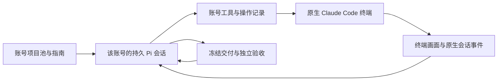

# Pi 指挥的 Projects

Projects 以账号控制者、持久项目工作区、实际终端操作和冻结交付组织。每个账号只有一个 Pi 控制者，Pi 直接决定 Claude Code 的下一步交流、菜单选择、方案确认、实施和返工。

项目研究与工程验收资产继续保留。研究项目和已具备独立程序验收的工程目标分别展示，研究完成数量不等于可执行任务数量。旧批次、旧运行、成果和原始状态继续保留；新 Projects 页面不展示旧历史入口，新工作使用独立数据表，不接续旧架构的在途任务。

## 使用

1. 在 v3 的 Projects 页配置外接模型。沿用原有服务地址和私有密钥存储，模型需要支持 OpenAI 兼容的流式响应与原生工具调用。
2. 选择账号、项目池、业务指南和本轮工作时间。项目池支持“全选”和“清空”，均作用于全部项目，包括被搜索筛选隐藏的项目；已选数量随勾选实时更新。保存后点击“启动 / 恢复 Pi”。保存配置本身不触发模型或账号请求。
3. 在同一页查看 Pi 的实际交互、Claude 终端、工程记录，以及分别统计的模型用量。通过“查看交付”检查历次冻结结果和修改源码。上游未提供的用量保持未知，部分统计明确标记为已知小计。
4. 暂停后保留工作区、Pi 上下文和 Claude 原会话。停止当前目标保留现场并结束该工作，之后可以开始新的目标。

Pi 会在当前项目池选择未完成的工程目标；研究路线作为资料，不再规定固定轮次、阶段或关键词。尚未具备独立工程合同的项目可以阅读研究，但不能冒充已验收任务。

## 控制链



- `account_state`：当前账号、已通过目标及未完成工作。
- `project_read`：授权项目的研究、业务目标与公开材料。
- `claude_start`：创建或恢复项目工作和原生会话，不自动代发问题。
- `claude_observe`：读取终端画面及原生消息增量，等待新变化。
- `claude_input`：发送原样文本、提交、方向键、快捷键及中断；引用最近观察。
- `project_submit`：冻结候选并执行修改范围、原生行为、回归及必要的独立语义审查。
- `account_wait`：等待条件变化，保留停止和账号门禁优先级。

工具进程绑定账号及控制代次，模型不能指定其他账号、容器、socket 或宿主路径。Pi SDK 不加载宿主或项目扩展，也不向模型开放管理机 shell。Claude Code 在原账号容器内使用现有开发权限。

停止和额度门禁在操作前重新检查。终端输入先保存意图；重复工具调用复用已有回执。无法确认发送结果时阻止新输入，管理员核对后明确记录“已发送”或“未发送”，再恢复原工作。

服务重启先由固定账号运行时清理并核对旧执行，再恢复此前正在工作的 Pi。人工暂停保持暂停；未知输入、身份变化、会话丢失、预算耗尽或环境收口失败保留现场和可见原因。恢复不重置任务累计预算，也不将新的内容合同套入旧工作。

明确额度或临时服务错误仅在尚未执行工具时按模型列表顺序降级；已操作终端的运行发生模型错误时保留进度。模型配置保存后，新启动或恢复的 Pi 使用新配置，在途控制者保持原配置。

## 代码与数据

| 文件 | 职责 |
| --- | --- |
| `orchestrator/projects.py` | 账号控制权、工作、输入意图、停止竞争及接受事实 |
| `orchestrator/projects_catalog.py` | 公开研究、工程合同及冻结内容版本 |
| `orchestrator/projects_runtime.py` | 固定账号租约、持久工作区及原生终端工具 |
| `orchestrator/projects_pi.py`、`images/pi-agent/host.mjs` | Python 与真实 Pi SDK 的独立进程管道 |
| `images/account/projects_cli.py` | 只监督 TUI，不编排对话或注入自动回复 |
| `orchestrator/projects_verification.py` | 独立程序验收与隔离的无工具语义审查 |
| `webui/projects.js` | 账号控制台、项目池选择、实时终端及工程记录 |

新数据表为 `projects_agents`、`projects_work`、`projects_actions`、`projects_events`、`projects_submissions`。Pi 会话保存在 `BENCH_DATA/projects/agents/<账号>/`，冻结候选和报告保存在 `BENCH_DATA/projects/submissions/`。实际源码保留在固定账号环境的项目目录。外接密钥仅通过私有管道交给 Pi，不进入操作记录或会话提示。

管理 API 使用 `/api/projects`，沿用既有 v3 鉴权和管理桥。旧项目 API 的修改入口拒绝执行；普通运行页也将旧项目运行标为只读。

Pi SDK 固定为 `@earendil-works/pi-coding-agent@0.75.1`，依赖由 `package-lock.json` 冻结，需要 Node 22.19 及以上版本。联合镜像增加控制端 Node、Pi SDK、研究资料和监督脚本，源码快照与管理桥白名单同步包含新资源。

## 验证

```bash
cd images/pi-agent
npm ci --ignore-scripts --no-audit --no-fund
npm test

cd ../../orchestrator
../.venv/bin/python -m unittest test_projects_agent test_projects_terminal -v

cd ..
.venv/bin/python deploy/v3/verify_pi_projects_browser.py
.venv/bin/python deploy/v3/run_local_verification.py \
  --manifest <包含新运行时的本地镜像清单> --pi-projects-only \
  --evidence-dir <新的证据目录>
```

隔离闭环使用实际 Pi SDK、Python 管道、固定账号 Docker 环境、真实 tmux 和独立 Docker 验收；模型上游和 Claude 均为本地合成对象。该证据证明执行机制，不代表真实 Claude 账号任务完成或线上已部署。
